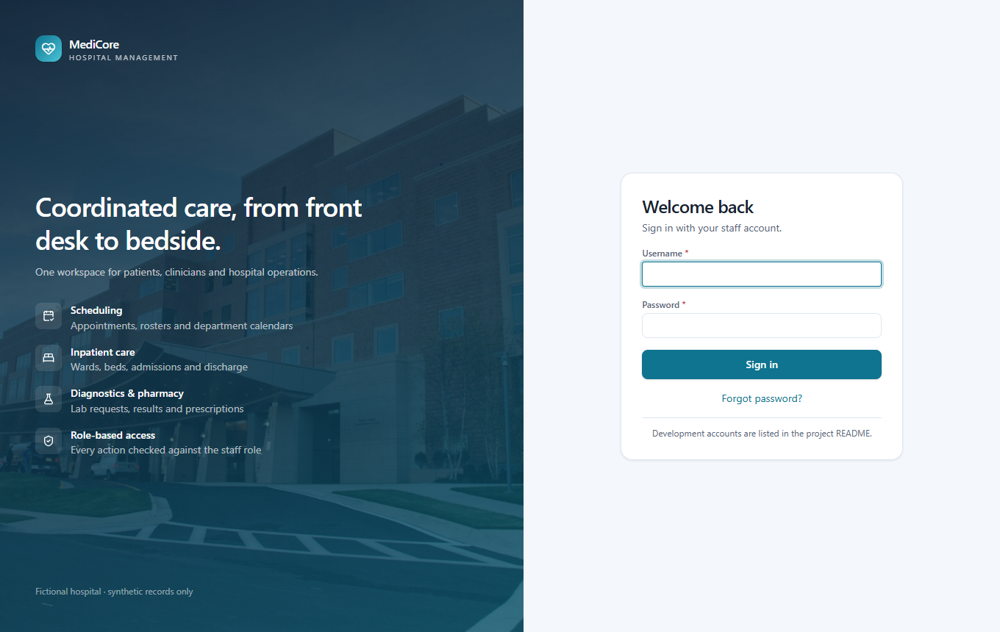
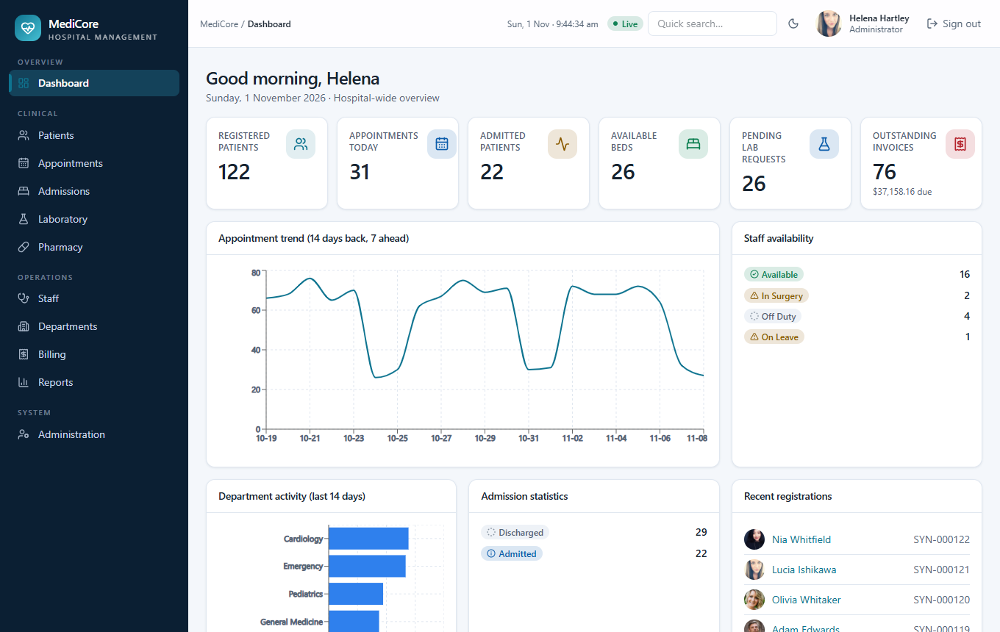
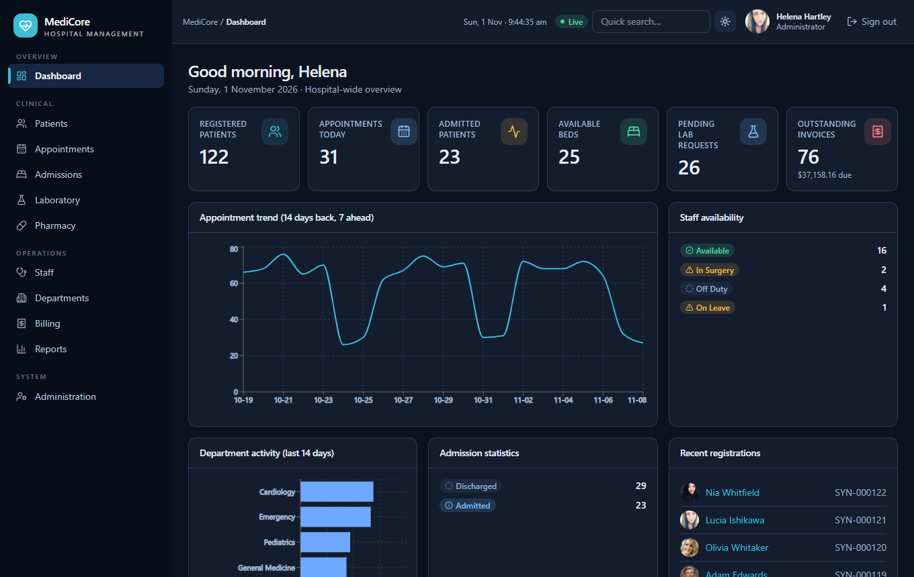
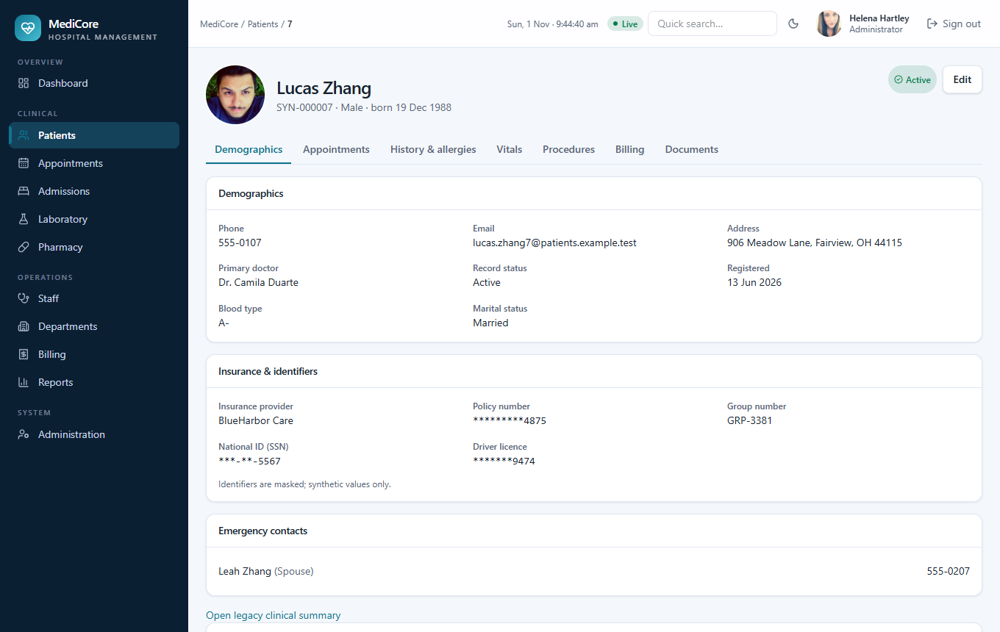
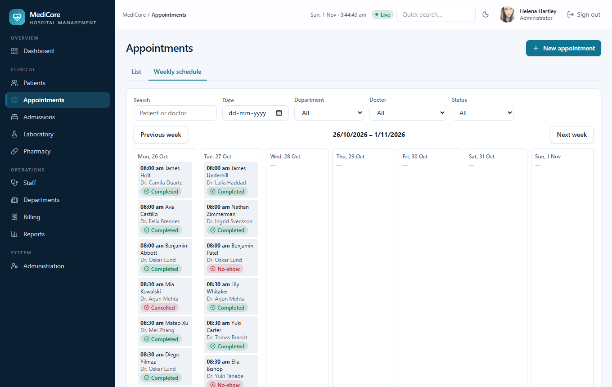
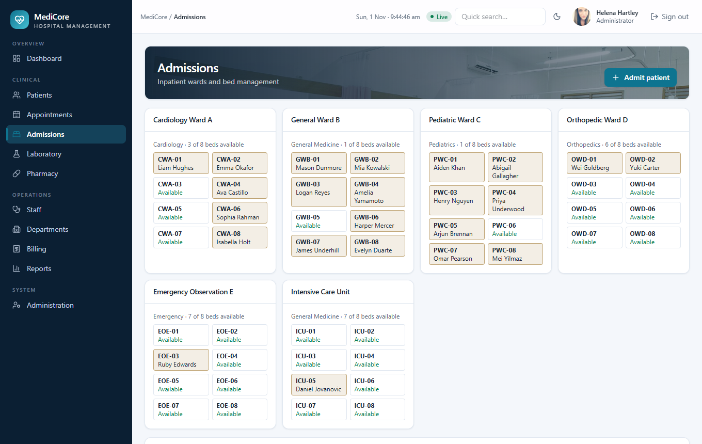
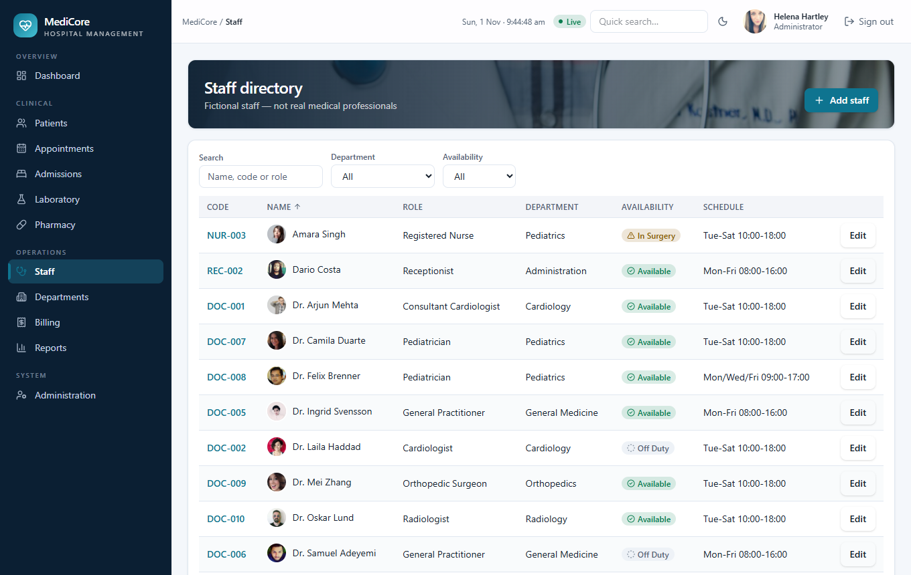
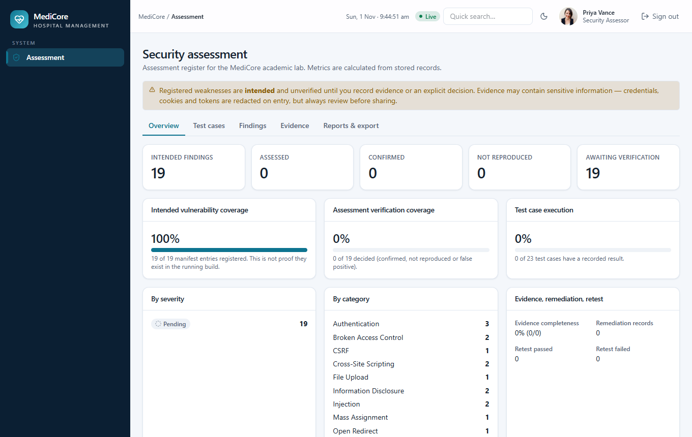

# MediCore HMS - intentionally vulnerable hospital management system

> **ACADEMIC SECURITY LAB - SYNTHETIC DATA ONLY - NOT FOR CLINICAL USE.**
> This application contains deliberately introduced security weaknesses. Run it only on your own machine, bound to `127.0.0.1`. Never deploy or expose it publicly.

MediCore is a realistic, full-stack hospital management system (React + Express + PostgreSQL) built as a target for Web Application Security assessment. It is a hardened build: 14 of the original 19 weaknesses have been remediated, and 5 deliberately remain for assessors to find (HMS-V03, V10, V14, V17, V18). It also has a role-based permission model, live-updating synthetic data, and an assessment area (findings, evidence, coverage metrics, exports) for the security assessor role.

All people, records, SSNs, insurance numbers and card numbers are **fabricated**: SSNs use the never-issued 9xx range, cards are public payment-processor test numbers, emails use `.example.test`.

## Features
- **Hospital modules:** dashboard, patients (demographics, insurance & identifiers, history, allergies, vitals, procedures, documents, billing), appointments (list + weekly schedule, conflict detection, status workflow), admissions & beds, staff, departments, laboratory, pharmacy, billing, operational reports, administration, profile & password reset.
- **Eight roles** with an explicit permission matrix (`backend/src/services/permissions.ts`) enforced by the backend, plus object-level scoping for doctors and nurses.
- **Realistic live data:** ~120 patients, per-doctor day-sheets, 48 beds, ~140 lab requests, prescriptions, invoices. A background simulator (disable with `LIVE_SIM=0`) checks patients in, progresses lab samples, records payments and admits/discharges patients; the UI updates over server-sent events (`/api/live`, anonymised messages only).
- **UI:** clinical design system, light/dark theme, responsive tables, accessible dialogs/forms, portraits and hospital photography (bundled locally).
- **Assessment area (assessor only):** test-case register, findings with status workflow, evidence with SHA-256 and secret redaction, separate coverage metrics, CSV/JSON/HTML export.

## Screenshots

| | |
|---|---|
| <br>**Sign in** | <br>**Live dashboard** |
| <br>**Dark theme** | <br>**Patient record** (masked identifiers, insurance) |
| <br>**Weekly schedule** | <br>**Wards and beds** |
| <br>**Staff directory** | <br>**Assessment area** (assessor role) |

## Stack
React 19, TypeScript, Vite, Tailwind 4, React Router, Recharts, Lucide · Express 5, Zod 4 · PostgreSQL 16 (Docker) or embedded PGlite (default, no Docker needed).

## Quick start (no Docker)
```bash
npm install
npm run start:lab        # API on 127.0.0.1:4000, weaknesses ON; embedded DB is created and seeded on first run
npm run dev:frontend     # UI on http://127.0.0.1:5173  (second terminal)
```
`npm run start:secure` runs the same app with every weakness **off** (the control build: `/api/lab/*` returns 404).

### Docker (PostgreSQL)
```bash
npm run docker:secure    # secure mode
npm run docker:lab       # vulnerable mode (adds docker-compose.lab.yml)
npm run docker:reset     # rebuild the synthetic dataset
```
All published ports bind to `127.0.0.1`; the database publishes no port. (`docker compose config` validates; the images have not been built in the development environment.)

## Test accounts (development only)
| Username | Password | Role |
|---|---|---|
| admin.hartley | LabAdmin#2026 | Administrator |
| doctor.mehta | LabDoctor#2026 | Doctor |
| doctor.svensson | LabDoctor#2026 | Doctor |
| nurse.okafor | LabNurse#2026 | Nurse |
| receptionist.lindqvist | LabFront#2026 | Receptionist |
| labtech.alvarez | LabTech#2026 | Laboratory technician |
| pharmacist.rossi | LabPharm#2026 | Pharmacist |
| billing.nakamura | LabBill#2026 | Billing officer |
| assessor.vance | LabAssess#2026 | Security assessor |

Password-reset codes are delivered to Administration → Local outbox (no email is sent). Five failed logins lock an account for 10 minutes.

## Commands
| Task | Command |
|---|---|
| Migrate / seed | `npm run db:migrate` / `npm run db:seed` |
| Reset clinical data (confirms first; keeps assessment records) | `npm run db:reset` (`-- --yes`, `-- --include-assessment`) |
| Typecheck / lint / build | `npm run typecheck` · `npm run lint` · `npm run build` |

Environment variables are listed in `.env.example` (`LAB_MODE`, `LAB_VULNS`, `HOST`, `PORT`, `DATABASE_URL`, `LIVE_SIM`, …). With no `DATABASE_URL` the database lives in `./.pglite`.

## Intended weaknesses
Five scenarios remain, isolated in `backend/src/assessment/vulnerable/` (and the login handler for HMS-V18), enabled only with `LAB_MODE=vulnerable` and individually switchable with `LAB_VULNS=HMS-V03,HMS-V14,…`:

IDOR/BOLA · verbose errors · open redirect · reflected XSS · user enumeration.

Remediated (code removed or fixed, now covered by security-control test cases): SQL injection (incl. blind), stored XSS, missing function-level authorization, mass assignment, weak password-reset token, session fixation, file-upload validation, missing security headers, CSRF via GET, path traversal, SSRF, JWT `alg:none`, exposed debug endpoint.

The internal manifest (`assessment/manifest/vulnerabilities.json`) describes each one (route, CWE/OWASP category, expected observation, assessment method, remediation). It is intentionally **not** served by the application except to the assessor role. If you are using this repository as an exercise, avoid reading the manifest and the `vulnerable/` directory before your own assessment. A manifest entry is not evidence that a weakness exists in a running build; findings start as *Not Tested* with severity *Pending*.

## Safety controls
- Default mode is secure, bound to `127.0.0.1`. Vulnerable mode refuses to start on a non-loopback `HOST` unless `LAB_ALLOW_CONTAINER_BIND=1` (set only by Compose, which publishes on `127.0.0.1`).
- `/api/lab/*` is mounted only in vulnerable mode.
- Hospital administrators hold no `assessment.*` permission and cannot create or modify assessor accounts.
- Reset exists only as a local CLI, refuses non-local DB hosts and `NODE_ENV=production`; there is no HTTP reset endpoint.
- The application makes no outbound HTTP requests. Secrets are never logged; evidence is redacted on entry.

See [docs/ARCHITECTURE.md](docs/ARCHITECTURE.md) and [docs/SAFETY.md](docs/SAFETY.md).

## Repository layout
```
backend/     Express API: routes/, services/ (rules, permissions, assessment, live, simulator), db/ (runner, seed, CLI), migrations/
  src/assessment/vulnerable/   ALL intentional weaknesses
frontend/    React app: pages/, components/ (ui, Layout, Avatar, vulnerable/LabTools), lib/
assessment/  manifest (internal), evidence & report output dirs (git-ignored contents)
lab-data/    synthetic files for the path-handling scenario
```

## Known limitations
- Docker images are untested in the original environment; ESLint is pinned to v9 (the react-hooks plugin does not support v10 yet).
- The frontend ships as a single ~770 kB bundle.
- Appointment times use the browser's local clock; the dashboard's "today" uses the database date, so they can disagree for a few hours around midnight.
- No OWASP ZAP scan or assessment report is bundled; the assessment itself is left to the user.

## Credits
Portraits are placeholder photographs from [randomuser.me](https://randomuser.me); hospital photographs are from [Unsplash](https://unsplash.com) (Unsplash License). They are shown with fictional names and records.
